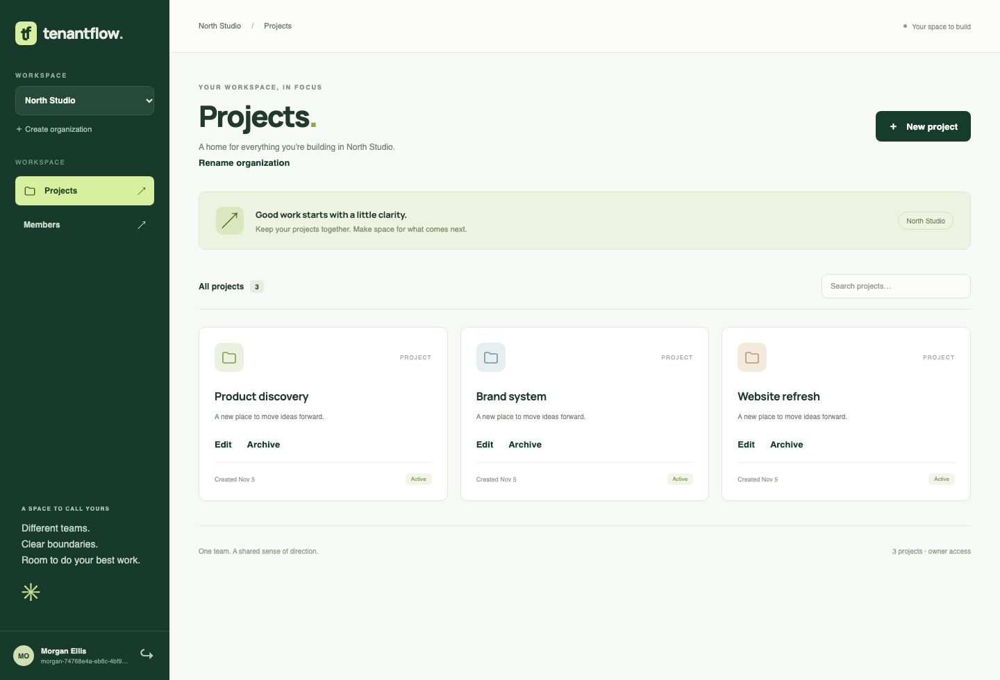

# TenantFlow

A multi-tenant project workspace demonstrating authorization boundaries and organization-scoped data.

**Status:** TF-00–TF-02 merged. TF-03 project rename/archive and organization rename are implemented and locally verified; its PR tracks review/integration. No public deployment yet. Constitution and MVP scope approved on October 25, 2026.

React + TypeScript, Node.js + Express, Better Auth and PostgreSQL with restricted runtime roles and row-level security. The app supports signup/sign-in, organizations, project creation/list/search, tenant switching and owner-managed memberships. Writers can rename/archive projects; owners/admins can rename organizations.



## Run locally

Requirements: **Node 24.22.1** (see `.node-version`) and Docker with Compose.

```sh
npm ci
npm run setup
npm run db:up
npm run db:migrate
npm run dev
```

Open http://localhost:4310. Create an account with a password of at least 12 characters, then create an organization and a project. Local signup does not send verification email. Use synthetic data.

Setup generates random local credentials in a gitignored `.env` and never overwrites it. Keep that file alongside the existing database volume; deleting it does not reset database passwords. PostgreSQL listens on local port 55432. Stop it with `docker compose stop db`; data persists in its volume.

## Manage members

Select an organization and open **Members**. Owners can add an already registered user by exact email, choose owner/admin/member/viewer, save a changed role, or remove a member after confirmation. Create a second account separately to try this locally; no invitation email is sent. The last owner cannot be removed or demoted, including simultaneous requests. Add another owner before transferring responsibility.

Admins, members and viewers cannot manage memberships. Server permissions change on the next request. The workspace refreshes its role and accessible organizations after changes and when the window regains focus; this is not a real-time push notification system.

## Edit and archive projects

Select a workspace and use **Edit** on a project card to rename it. Names are trimmed and limited to 1–120 Unicode characters. Owners, admins and members can edit/archive; viewers have read-only controls and the API rejects their writes.

**Archive** opens a confirmation. Confirming hides the project from the default list/search while retaining its data. Cancel changes nothing. Archive is safe to repeat; archived projects cannot be edited. There is no restore or archive-browser UI in this delivery. Authorized detail remains available through `GET /api/organizations/:orgId/projects/:projectId` with `archived_at`.

Owners/admins can choose **Rename organization** below the Projects heading. Saving refreshes the workspace selector and heading. Forms show pending/error states, and drafts survive recoverable service errors. Changing workspace/role cancels requests and closes old forms; revoked membership is revalidated on the next request.

## Verify

With PostgreSQL running and migrations applied:

```sh
npx playwright install chromium
npm run check
```

Stop an existing development server before the browser checks: Playwright owns port 4310 during the run. The checks type-check code, build the web bundle, run real-database integration tests and exercise Chromium at desktop and mobile sizes. Tests create synthetic accounts and organizations in the local database.

Local results: **37 integration tests and 20 browser scenarios passed**, plus type checking and production web build. [Verification and limits](docs/verification.md) distinguish the initial slice from the complete MVP. CI runs the same commands on pull requests; see the PR for its independent result.

## Engineering records

- [TF-03 lifecycle contract](specs/001-tenant-isolation/contracts/project-lifecycle.md), [ADR](docs/adr/0004-project-lifecycle.md) and [checkpoint](docs/checkpoints/2026-11-05-project-lifecycle.md)
- [Architecture and trust boundaries](docs/architecture.md)
- [Identity decision](docs/adr/0002-identity.md)
- [MVP specification](specs/001-tenant-isolation/spec.md)
- [Implementation plan](specs/001-tenant-isolation/plan.md)
- [Tasks and completion checklist](specs/001-tenant-isolation/tasks.md)
- [First-slice checkpoint](docs/checkpoints/2026-10-25-first-slice.md)
- [Constitution](.specify/memory/constitution.md) and [approval](docs/governance.md)
- [Release checklist](docs/release-checklist.md) and [Spec Kit setup](docs/spec-kit.md)
- [Open work](https://github.com/msalomonn/tenantflow/issues)

The original targets were November 6, 2026 for the local MVP and November 13 for public release; dates remain tentative. TF-02 merged in PR #8. TF-03 completes project editing/archiving and organization renaming; see its PR for integration status. TF-04 acceptance/dependency hardening and TF-05 deployment remain open. Local verification is not production-readiness evidence.

The cross-project roadmap lives in [portfolio-engineering](https://github.com/msalomonn/portfolio-engineering).
