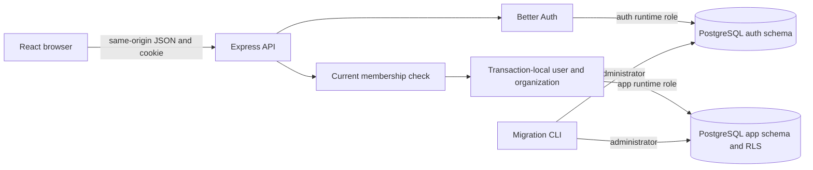

# TenantFlow architecture

Identity comes from a verified session; an organization in the route is requested scope, not authority. Membership is checked before project operations. Transaction-local context is cleared on commit/rollback before returning pooled connections. RLS checks membership and selected organization; INSERT and project UPDATE additionally require a writer role; organization UPDATE requires owner/admin. Column grants limit updates to lifecycle fields. Unscoped project queries expose no rows. Runtime roles cannot change policies or own tenant tables.

Organization creation uses a narrow SECURITY DEFINER function because the first owner membership does not yet exist. It uses an empty search path, qualified relations, revoked PUBLIC execution and session-derived identity. Organization and owner are inserted atomically. This protects against missing filters and unauthorized routes; it does not defend against a compromised server that can choose arbitrary database context.

React keys the project component by organization and role, closing its dialogs and aborting list/mutation requests on unmount. A delayed-response browser test checks that old results cannot replace the selected workspace.

| Method | Path | Behavior |
| --- | --- | --- |
| POST | `/api/auth/sign-up/email` | Library-managed registration/session |
| POST | `/api/auth/sign-in/email` | Sign-in |
| POST | `/api/auth/sign-out` | Persisted session revocation |
| GET | `/api/me` | Current user or 401 |
| GET / POST | `/api/organizations` | Accessible list / atomic owner bootstrap |
| GET / POST | `/api/organizations/:orgId/projects` | Scoped list / writer create |
| GET | `/api/organizations/:orgId/projects/:projectId` | Scoped detail, including archived metadata, or 404 |
| PATCH | `/api/organizations/:orgId/projects/:projectId` | Writer rename or idempotent archive |
| PATCH | `/api/organizations/:orgId` | Owner/admin rename |
| GET | `/api/health` | Database connectivity |

The draft's `/api/logout` becomes Better Auth's canonical `/api/auth/sign-out`. Owner-only membership management now uses the routes in the [TF-02 contract](../specs/001-tenant-isolation/contracts/memberships.md). Project lifecycle follows the [TF-03 contract](../specs/001-tenant-isolation/contracts/project-lifecycle.md): row-serialized updates, retained archived rows and default active-only lists.

Membership writes remain unavailable as direct table grants. Owner-only security-definer operations lock the organization row and recheck actor authority before modifying memberships or counting owners. The application role cannot query the auth user directory directly. Member listing exposes only identity and role for the selected organization and requires owner authority. [ADR 0003](adr/0003-membership-serialization.md) records this boundary.

## Portable function ownership (TF-05a)

Migration004 transfers the bootstrap/member functions to a dedicated no-login, non-superuser role with explicit grants and policies. FORCE RLS remains on tenant tables; runtime roles cannot inherit or assume the function role. Startup/migration preflight rejects unsafe role flags or direct/indirect runtime membership. Schema CREATE is granted only during ownership transfer and revoked before commit. See [ADR0006](adr/0006-portable-definer-role.md) and the [role contract](../specs/002-public-demo/contracts/database-roles.md). Managed-provider privileges and production ingress are still deployment preflight work.
